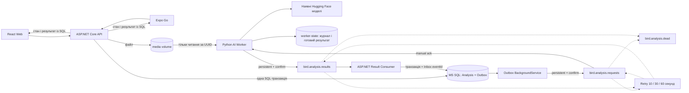
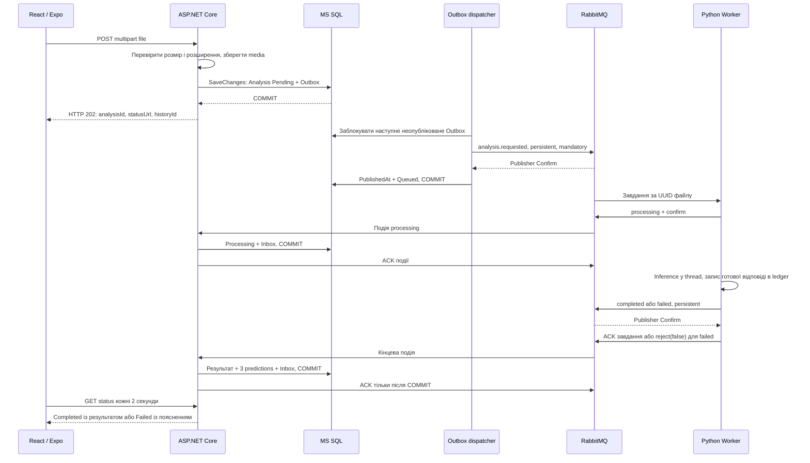

# RabbitMQ в AI Bird Lab

## Архітектура



RabbitMQ переносить події між процесами. MS SQL зберігає стан лабораторії, історію та TOP-3. Worker SQLite — лише локальний технічний журнал спроб і готових відповідей; клієнти його не використовують.



## Терміни і topology

**Producer** публікує подію. Тут це ASP.NET Outbox dispatcher для завдань та Python Worker для подій обробки. **Consumer** отримує повідомлення: worker слухає завдання, ASP.NET слухає результати. **Queue** зберігає повідомлення до підтвердження. **Exchange** спрямовує їх у черги за routing key. Використано direct exchanges.

| Exchange | Routing key | Черга |
| --- | --- | --- |
| `bird.analysis` | `analysis.requested` | `bird.analysis.requests` |
| `bird.analysis` | `analysis.event` | `bird.analysis.results` |
| `bird.analysis.dlx` | `analysis.dead` | `bird.analysis.dead` |
| `bird.analysis.retry` | `requests.1`, `.2`, `.3` | `bird.analysis.requests.retry.1/2/3` |
| `bird.analysis.retry` | `results.1`, `.2`, `.3` | `bird.analysis.results.retry.1/2/3` |

Усі дев’ять черг durable та типу **quorum**. Повідомлення завдань, результатів і повторів persistent; усі програмні публікації мають `mandatory=true` та Publisher Confirms. `mandatory` виявляє відсутній маршрут, confirm підтверджує прийняття брокером.

На одному вузлі quorum має одну репліку. Вибір пов’язаний із `at-least-once` dead lettering: джерельна черга тримає повідомлення, доки цільова не підтвердить його прийняття. Це не кластер і не захист від фізичної втрати диска. Накладні витрати дев’яти невеликих черг прийнятні для цієї лабораторії. [Офіційний опис quorum і надійного DLX](https://www.rabbitmq.com/docs/quorum-queues).

Dead Letter Exchange та TTL задаються policies в `rabbitmq/definitions.json`, не hardcoded DLX-аргументами клієнтів. Робочі черги мають `delivery-limit=5`, `dead-letter-strategy=at-least-once`, `overflow=reject-publish`. У DLQ вимкнено delivery limit, оскільки вона не має автоматичного consumer і повинна зберігати діагностичні повідомлення після ручних переглядів. Автоматично повертати DLQ у роботу заборонено логікою застосунку.

Брокер використовує зафіксований офіційний `rabbitmq:4.4.0-management`; версію перевірено через Management API. [Офіційний образ](https://hub.docker.com/_/rabbitmq), [відомості про релізи](https://www.rabbitmq.com/release-information). Клієнти: `RabbitMQ.Client 7.2.2`, `aio-pika 10.2.1`.

## Версіоновані повідомлення

Request v1 містить `schemaVersion`, `eventId`, `analysisId`, `analysisType`, `fileId`, `fileSha256`, `createdAt`, `correlationId`. Файлів та довільних шляхів у JSON немає. Формати UUID і SHA-256 суворо перевіряються.

Подія v1 містить `schemaVersion`, `eventId`, `analysisId`, `correlationId`, `causationId`, `status`, `occurredAt`, `retryCount`. `causationId` повинен збігатися з eventId SQL Outbox. Можливі події: `processing`, `completed`, `failed`.

Для `completed` обов’язкові `predictedSpecies`, `confidence`, рівно три `predictions` з `species`, `scientificName`, `confidence`, `rank`, а також `modelName`, `modelRevision`, `elapsedSeconds`, `metadata.mock_used=false`. Назви у TOP-3 унікальні, ranks — 1/2/3, confidence скінченний у межах 0..1 і впорядкований за спаданням. Для `failed` потрібний `errorMessage`. Дати подій UTC. Ліміт повідомлення — 64 КБ.

JSON-схеми обох мов узгоджені з реальними повідомленнями; джерела — `Messaging/Events.cs` і `bird_worker/contracts.py`. Невідома версія та зайві поля відхиляються. `eventId` є AMQP MessageId, `correlationId` також передається в AMQP properties. Назви птахів залишаються буквальним виходом моделі; довідкові картки приєднуються тільки за наявним перевіреним scientific name.

## Файли та моделі

ASP.NET створює випадковий безпечний ключ `<fileId у форматі N>.<дозволене розширення>` та SHA-256. Worker має read-only mount того самого volume `media`. Він будує лише фіксований список можливих імен за UUID, забороняє symlink за межі root, перевіряє розмір та hash. Абсолютний шлях із повідомлення не приймається.

Пошкоджене зображення або непідтримуваний вміст виявляє наявний декодер. Worker використовує ті самі `classify_image`, `classify_audio` і потокобезпечний кеш, що й FastAPI. Prefetch — 1, одночасно виконується один inference. Обчислення перенесене в `asyncio.to_thread`, тому heartbeat та AMQP не блокуються роботою моделі. Моделі завантажуються один раз на процес та повторно використовуються.

## Outbox і acknowledgments

Один `SaveChangesAsync` EF у SQL-транзакції створює Analysis та Outbox. Збій між цими операціями не залишає половину SQL-завдання. Файл записується перед SQL; при невизначеному результаті COMMIT він не видаляється, щоб не втратити вже зафіксоване медіа. Можливі ізольовані orphan-файли після невдалого SQL-запиту; автоматичного видалення користувацьких файлів немає.

Outbox dispatcher бере запис через `UPDLOCK, READPAST, ROWLOCK`, публікує з confirm і тільки потім встановлює `PublishedAt` та `Queued`. У разі збою після confirm, але до COMMIT, повторюється та сама подія з тим самим eventId. Worker розпізнає її за журналом. Паралельні екземпляри dispatcher не захоплюють той самий SQL-запис одночасно.

Outbox повторює недоставлені події з експоненційною затримкою до 60 секунд. Ці transport-повтори не обмежуються чотирма спробами inference: тривала недоступність брокера не повинна знищувати вже прийняті SQL-завдання. Зберігаються число публікацій, остання помилка та дата наступної спроби.

**Acknowledgment** означає, що consumer дозволив видалити конкретну доставку з черги. Worker надсилає ACK вихідного завдання лише після підтвердження кінцевої події брокером. Готова відповідь спочатку синхронно записується в SQLite ledger з `synchronous=FULL`; її eventId зберігається після перезапуску. Якщо confirm загублено, повторна доставка використовує ту саму відповідь, не вигадуючи нового результату.

ASP.NET зберігає Inbox eventId та SHA-256 тіла в одній транзакції з результатом. ACK іде після COMMIT. Повтор тієї самої події не створює другого аналізу або ще трьох predictions; повтор eventId з іншим вмістом відхиляється. `Completed` і `Failed` — термінальні стани: запізнілий `processing` не повертає їх назад.

Гарантія — доставка щонайменше один раз із ідемпотентним збереженням. Якщо процес аварійно завершився під час inference до запису готової відповіді, саме обчислення може виконатися ще раз. Журнал спроб переживає перезапуск; файлове блокування не дозволяє двом worker одночасно використовувати один ledger. Для цієї конфігурації передбачено один worker.

## Помилки, retries та DLQ

Постійні помилки файлу дають `failed`; вихідне завдання після confirmed події відхиляється з `requeue=false` і потрапляє у DLQ. Некоректні JSON/UUID/версія теж надходять у DLQ. Якщо повідомлення не має достовірного ID, створити для нього новий аналіз неможливо і не потрібно.

Тимчасові `ModelError`, помилки доступу до root сховища та мережеві збої inference мають до чотирьох спроб загалом. Номер зберігається в ledger перед початком роботи. Після спроб 1/2/3 завдання підтверджено переноситься в retry queues з TTL **10/30/60 секунд**, звідки policy повертає його до requests. Четверта невдала спроба формує `failed` і DLQ.

Для недоступної SQL-бази result consumer обмежує тривалість однієї спроби, публікує confirmed копію у results retry і лише потім ACK попередньої доставки. Після трьох відкладених повторів кінцеве повідомлення залишається у DLQ. Якщо публікація retry не підтверджена, попередня доставка не визнається успішною; перепідключення має паузу і немає циклу миттєвого requeue.

Після відновлення SQL можна повернути тільки події результатів із DLQ:

```powershell
docker compose exec -T worker python ai-server/replay_results.py
```

Команда переносить події через Publisher Confirms, а решту повідомлень зберігає у DLQ. Inbox знову захищає від дублікатів. Не запускайте автоматичний циклічний replay: пошкоджені повідомлення потребують окремої діагностики.

Завдання без оновлення понад 15 хвилин мають `stalled=true` в status API та warning у логах. Це діагностична ознака, не вигаданий відсоток готовності. Перевірте Outbox, активні consumers, Ready/Unacked, доступність SQL/media та DLQ. Після вичерпання crash delivery-limit повідомлення може бути в DLQ, а SQL — ще в Processing; адміністратор має дослідити причину. Завдання навмисно не переводиться у Failed лише через довге очікування, оскільки воно може законно стояти в черзі.

## Lifecycle і health

RabbitBus тримає довгоживуче з’єднання. Publisher-канал захищений `SemaphoreSlim`; consumer використовує свій канал. Перша невдала спроба та розрив після встановлення з’єднання проходять через явний цикл повторного підключення. Немає непотокобезпечного спільного доступу до channel. Python використовує `connect_robust`.

При SIGTERM worker припиняє брати наступні завдання і завершує поточне в межах grace period 90 секунд. SIGKILL залишає unacked delivery брокеру. ASP.NET скасовує consumer, обмежено очікує активний handler і закриває канал; незавершені доставки повертаються брокеру. Журнал worker та SQL не залежать від життєвого циклу контейнера.

`/api/health` окремо повертає `central`, `database`, `ai`, `rabbitmq`, `worker`, `resultConsumer`. За відсутності необхідного компонента — HTTP 503 і `status=degraded`. Worker-перевірка означає наявність AMQP consumer; вона не вимірює якість моделі або час майбутнього inference. `/api/health/live` підтверджує лише доступність ASP.NET-процесу.

У Compose є healthchecks, restart policies, SQL migration job та явні залежності. Топологія імпортується після готовності самого RabbitMQ; це обходить виявлене зависання раннього boot import. Readiness брокера виставляється після ініціалізації користувача, permissions та перевірки наявності всіх дев’яти черг і дев’яти binding. Усі клієнти підключаються до внутрішнього `rabbitmq:5672`, Management прив’язаний до loopback хоста.
