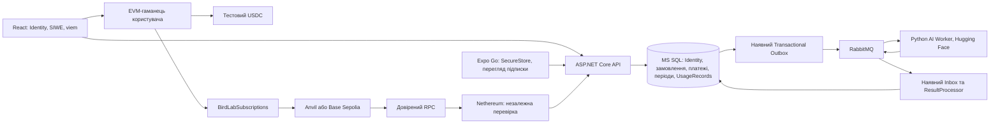

# Криптовалютні підписки AI Bird Lab

Підписка — передплачений доступ на визначений строк. Кожна покупка та ERC-20 approval підтверджуються користувачем вручну. Автоматичного списання, зберігання приватних ключів користувача й кастодіального гаманця немає. Це навчальна реалізація для тестових мереж; незалежного аудиту платіжної безпеки не проводили.

## Архітектура



SQL Server є джерелом істини щодо доступу. RabbitMQ обробляє наявні AI-завдання. Події підписок до черги не додавали: вони необов'язкові для цієї реалізації. Streamlit, SQLite, CSV, моделі та старі файли залишилися окремим локальним дослідницьким інтерфейсом; серверні тарифи захищають центральний API. Доступ до машини розробника, моделей, SQL або адміністративних облікових даних брокера не є клієнтською межею безпеки.

## Тарифи та періоди

| Тариф | Демонстраційна ціна | Період і ліміт | Можливості |
|---|---:|---|---|
| FREE, ID 0 | 0 | 5 аналізів за добу UTC | Фото, власна історія, базові картки птахів |
| PRO, ID 1 | 5 тестових USDC | 30 днів, 100 аналізів | FREE, аудіо, галерея, розширена статистика |
| PREMIUM, ID 2 | 10 тестових USDC | 30 днів, 500 аналізів | PRO, пакетні фото, порівняння, статистика еталонних оцінок |

`SubscriptionPlans.Price` зберігає цілі найменші одиниці токена: за 6 decimals значення `5000000` означає 5 USDC. API передає грошові суми рядками, React використовує `bigint`. Значення `double` у передбаченнях залишилися лише confidence та тривалістю AI, не платежами.

Ціни, тривалість, ліміти, активність та перелік відомих можливостей задаються в MS SQL. Дозволені ідентифікатори можливостей: `image`, `audio`, `history`, `basicInfo`, `gallery`, `statistics`, `batch`, `compare`, `advancedStatistics`. Умови копіюються в замовлення і оплачений період, тому редагування тарифу не змінює вже придбані права. Нові самостійні можливості потребуватимуть своєї реалізації.

Продовження того самого тарифу створює наступний період від `max(UTC now, останнє EndDate)`. Його статус — `Scheduled`, ліміт починає діяти з початку цього періоду. Залишок попереднього ліміту не переноситься. У «Моя підписка» показано поточний період; майбутній видно в історії періодів.

Зміна платного тарифу відбувається негайно лише з `replaceCurrentPlan=true`, якому відповідає окремий checkbox у checkout. Попередні активні й заплановані періоди стають `Replaced`; залишок днів і ліміту втрачається без пропорційного повернення. Новий тариф отримує повний власний строк і ліміт. Без явної згоди сервер повертає 409. FREE працює без гаманця і стає ефективним одразу після завершення платних прав.

## Авторизація та старі записи

До розширення в API не було Identity/JWT і власників аналізів. Додано ASP.NET Core Identity з хешуванням паролів, унікальним email, паролем від 12 символів, блокуванням після 5 невдалих входів та обмеженням частоти auth-запитів.

Використано відкличні непрозорі сесійні токени, а не JWT. Токен має 256 біт випадковості; у SQL лежить тільки SHA-256. Строк — 8 годин. Веб використовує HttpOnly cookie з SameSite=Lax і Secure на HTTPS; Expo — Bearer у SecureStore. Logout видаляє серверну сесію. Прострочена сесія потребує повторного входу. Поза `Development` вхід і реєстрація вимагають HTTPS. CORS дозволяє лише налаштовані origin; сторонні Origin не можуть виконувати мутації.

Міграція `20261103154944_CryptoSubscriptions` додає nullable `Analyses.UserId`, не призначає старі рядки новим користувачам і не видаляє старі результати. Стара історія є архівом без власника. Доступ на читання до `/api/legacy/archive` і `/api/legacy/archive/{id}/file` надає власник системи конкретним ID облікових записів у `Auth:LegacyArchiveReaders`. За замовчуванням список порожній. Автоматичного присвоєння архіву, включно з першим зареєстрованим користувачем, немає. За потреби іншої міграції потрібне окремо затверджене зіставлення власників та контрольний експорт.

Для SIWE сервер генерує точне повідомлення із доменом, URI, адресою EIP-55, chain ID, випадковим nonce, issued-at, expiration та ID користувача. Підпис перевіряється Nethereum; сервер звіряє повний текст зі збереженим, домен, мережу, користувача, строк і одноразовість. Транзакція SQL та блокування користувача не дозволяють використати nonce двічі. Один перевірений гаманець не прив'язується до двох облікових записів. Підтримуються EOA-підписи `personal_sign`; EIP-1271 та смарт-акаунти потребують окремого розширення.

## Платіжний контракт і перевірка

`contracts/src/BirdLabSubscriptions.sol` використовує OpenZeppelin 5.4.0: IERC20, SafeERC20, Ownable2Step, ReentrancyGuard і Pausable. Токен незмінний після розгортання. Власник задає ціни тарифів, призупиняє покупки і виводить тільки отримані токени. Передача володіння потребує підтвердження нового власника.

```solidity
purchaseSubscription(bytes32 orderId, uint256 planId)
SubscriptionPurchased(bytes32 indexed orderId, address indexed payer, uint256 indexed planId, uint256 amount, address token)
```

`orderId` містить адресу перевіреного платника у перших 20 байтах і 12 криптографічно випадкових байтів. Контракт звіряє адресу з `msg.sender`, що захищає замовлення від випереджувальної оплати іншою адресою. Використані замовлення зберігаються у `paidOrders`; повторна покупка не списує токени. Контракт бере поточну ціну тарифу і перевіряє фактично отриману суму. Токени з комісією за transfer відхиляються.

Сервер створює замовлення тільки для підтвердженого гаманця, бере умови з SQL і попередньо звіряє через RPC chain ID, наявність контракту, його токен, decimals, ціну та pause. Клієнт не задає суму або одержувача.

Після передачі хешу сервер отримує транзакцію та receipt самостійно. Він перевіряє chain ID RPC, хеш, `from`, `to`, нульовий native value, точні calldata, успішність receipt, канонічний block hash, адресу емітента події, orderId, planId, платника, токен, точну суму, час включення та кількість підтверджень. Клієнтський receipt/JSON або текст «успішно» доказом не є.

Типовий строк замовлення — 30 хвилин. Політика строку: **транзакція повинна бути включена до канонічного блоку не пізніше `ExpiresAt`**; перевірити її дозволено пізніше під час відновлення RPC. Сам контракт не перевіряє наявність замовлення у SQL або його TTL. Оплата невідомого/простроченого замовлення через прямий виклик контракту може перевести токени без надання доступу. Веб перевіряє строк до надсилання, але це не on-chain повернення коштів.

Ціни контракту та SQL потрібно змінювати узгоджено під час паузи покупок, після завершення строків старих відкритих замовлень. Не змінюйте ціну під час чинних checkout: знижена on-chain ціна може дати подію на суму, що не відповідає знімку замовлення; сервер її відхилить. Для комерційного використання слід окремо аудіювати підписані сервером on-chain замовлення, TTL, зміну ціни й повернення коштів.

SQL має унікальні orderId, оплачений період для PaymentOrderId та унікальний індекс `(ChainId, TransactionHash, LogIndex)` для подій. Підтвердження, платіж, замовлення і права зберігаються однією транзакцією під `sp_getapplock` для користувача. Повторна обробка не змінює EndDate вдруге. Платіж, що конфліктує зі зміненим тарифом без належної згоди, переходить у `ReviewRequired`, а не створює подвійні права.

SubscriptionMonitor повторює перевірки Pending/Reorged та аудит Confirmed. Тимчасова помилка RPC не створює нову підписку й не скасовує вже перевірену. Втрата канонічного платежу переводить його період у Reorged і забирає права. Повторне канонічне включення відновлює той самий період, без нового строку. Раніше замінені періоди відновлюються лише за відсутності новіших чинних прав. Звичайні L2 confirmations не є доказом фінальності на Ethereum L1.

## Ліміти та AI

Авторизація й перевірка можливостей діють на API, включно із sync, batch, порівнянням, статистикою, галереєю, історією і медіа. Базові лічильники власної історії доступні FREE; агреговані confidence для FREE повертаються null. Усі запити до результатів фільтруються за UserId. Знання числового ID, JobId або file URL не дає доступу до чужого запису.

Прийняття завдання, UsageRecord і наявний Outbox записуються однією SQL-транзакцією. `sp_getapplock` серіалізує резерви, активації та зміни періоду для одного користувача, у тому числі між екземплярами API. У batch право `batch` повторно перевіряється всередині кожного резерву. Один прийнятий файл — одна одиниця; batch з N прийнятих файлів — N одиниць. FREE рахує Reserved+Consumed у межах доби UTC; платний тариф — власний лічильник періоду.

Completed переводить Reserved у Consumed. Остаточний Failed повертає резерв один раз. Повторний/пізній event не повертає ліміт повторно. Видалення готового аналізу не видаляє UsageRecord і не відновлює ліміт. Зависле завдання без terminal event не повертає резерв автоматично: потрібне відновлення outbox/worker або контрольована діагностика, щоб пізній успішний результат не обійшов ліміт.

Для ізольованого інтеграційного прогону додано `RabbitMQ:VirtualHost` та `RABBITMQ_VHOST`; типове значення `birdlab` залишилося. Повний протокол створює окремий тестовий vhost і окрему SQL-базу, не очищає робочі черги й не видаляє volumes.

## Локальний запуск Windows

Потрібні .NET 10, SQL Server Express, Python venv із наявними залежностями, Node, Docker для RabbitMQ та Foundry. Виконуйте команди у звичайному дозволеному терміналі. Не вимикайте Windows Application Control: у разі блокування зберіть проєкт у дозволеному середовищі або передайте повідомлення адміністратору.

З кореня `C:\ITSTEP\AI\Birds` встановіть залежності, зберігаючи наявний `.env`:

Якщо це свіжий комплект без `.venv`, спочатку створіть Python-середовище. У наявному робочому проєкті повторно створювати його не потрібно:

```powershell
python -m venv .venv
.\.venv\Scripts\python.exe -m pip install -r requirements.txt
.\.venv\Scripts\python.exe -m pip install -r ai-server/requirements.txt
.\.venv\Scripts\python.exe scripts/download_models.py
```

Завантаження справжніх моделей потребує мережі та значно більше місця, ніж 25 МБ вихідного комплекту. Якщо кеш уже є, збережіть його й не завантажуйте моделі повторно.

```powershell
dotnet restore central-server.Tests
npm --prefix web-app ci
npm --prefix mobile-app ci
npm --prefix contracts ci
.\.venv\Scripts\python.exe scripts/setup_env.py
dotnet run --project central-server -- --migrate-db
```

Перевірте контракт і запустіть Anvil в окремому терміналі:

```powershell
cd C:\ITSTEP\AI\Birds\contracts
forge test -vv
forge test --gas-report
anvil --host 127.0.0.1 --port 8545 --chain-id 31337 --silent
```

Локальний деплой не потребує приватного ключа: він використовує unlocked тестові облікові записи виключно на loopback Anvil із chain ID 31337.

```powershell
cd C:\ITSTEP\AI\Birds
.\.venv\Scripts\python.exe scripts/local_blockchain.py
```

Актуальні адреси й справжні deployment hashes записуються в `verification/local-deployment.json`. Після перезапуску Anvil без збереженого стану виконайте деплой знову. Не вважайте адресу зі старого звіту чинною у порожньому новому ланцюжку.

Для host API/worker відкрийте AMQP лише на loopback:

```powershell
docker compose -f compose.yaml -f compose.local.yaml up -d rabbitmq
.\scripts\run_worker_local.ps1
```

В окремих терміналах запустіть FastAPI та ASP.NET. FastAPI потребує наявного `AI_INTERNAL_KEY` у локальному середовищі; не виводьте його значення. `run_central_local.ps1` і `run_worker_local.ps1` читають локальний `.env` без друку секретів.

```powershell
.\scripts\run_ai_local.ps1
.\scripts\run_central_local.ps1
```

Веб:

```powershell
cd C:\ITSTEP\AI\Birds\web-app
npm run dev
```

Відкрийте `http://localhost:5173`, зареєструйтеся, виберіть PRO. Для локального MetaMask додайте Local Anvil, RPC `http://127.0.0.1:8545`, chain ID 31337. Можна використовувати власний окремий тестовий гаманець без передачі seed/private key застосунку. Отримайте тестовий ETH командою `anvil_setBalance`, а MockUSDC — через mint. Адреси нижче потрібно підставляти зі свого локального деплою та власного гаманця:

```powershell
$deployment = Get-Content .\verification\local-deployment.json -Raw | ConvertFrom-Json
$testWallet = Read-Host 'Адреса вашого окремого тестового EVM-гаманця'
cast rpc --rpc-url $deployment.rpcUrl anvil_setBalance $testWallet 0xDE0B6B3A7640000
cast send $deployment.tokenAddress 'mint(address,uint256)' $testWallet 20000000 --rpc-url $deployment.rpcUrl --unlocked --from $deployment.ownerAddress
```

Ці команди призначені тільки для локального Anvil. Не використовуйте його відкриті тестові акаунти для реальних коштів. У checkout окремо натисніть підпис SIWE, створення замовлення, точний approval і платіж; перевірте invoice й попередження про незворотність. Для локального режиму з 3 confirmations додайте блоки після платежу:

```powershell
cast rpc --rpc-url http://127.0.0.1:8545 anvil_mine 0x2
```

## Base Sepolia

Параметри перевірено за офіційними документами: chain ID **84532**, RPC `https://sepolia.base.org`, USDC `0x036CbD53842c5426634e7929541eC2318f3dCF7e`, decimals **6**, explorer `https://sepolia.basescan.org`. Адреса BirdLabSubscriptions у цій мережі навмисно порожня до власного перевіреного деплою.

Отримайте тестовий ETH через ресурси Base та тестові USDC через [Circle Faucet](https://faucet.circle.com/). Застосунок не автоматизує faucet, CAPTCHA або зовнішню реєстрацію. Підготуйте окремий зашифрований Foundry keystore чи апаратний підписувач. Не записуйте приватний ключ у команду, `.env.example`, git або звіт.

```powershell
cd C:\ITSTEP\AI\Birds\contracts
$env:BIRD_TOKEN_ADDRESS = '0x036CbD53842c5426634e7929541eC2318f3dCF7e'
$env:BIRD_OWNER_ADDRESS = Read-Host 'Публічна адреса тестового деплойера-власника'
$env:BIRD_PRO_PRICE_ATOMIC = '5000000'
$env:BIRD_PREMIUM_PRICE_ATOMIC = '10000000'
forge script script/DeployBaseSepolia.s.sol:DeployBaseSepolia --rpc-url https://sepolia.base.org --account birdlab-test-deployer --sender $env:BIRD_OWNER_ADDRESS --broadcast
forge inspect src/BirdLabSubscriptions.sol:BirdLabSubscriptions abi
```

`birdlab-test-deployer` — заздалегідь підготовлений локальний зашифрований keystore, а адреса owner має відповідати підписувачу для початкового встановлення цін. Скрипт відмовляється працювати на іншому chain ID або іншій адресі тестового USDC. Деплой у Base Sepolia під час цієї роботи не виконувався. Mainnet не підтримується: backend і frontend відхиляють інші мережі незалежно від прапорця Enabled.

Після перевірки bytecode/ABI, `paymentToken()`, `prices(1)`, `prices(2)` та owner задайте локально `BLOCKCHAIN_ENABLED=true`, `BLOCKCHAIN_CHAIN_ID=84532`, власну адресу контракту й потрібний RPC. Для браузера використовується окремий `BLOCKCHAIN_PUBLIC_RPC_URL` без секретного API key; приватний серверний RPC публічний endpoint не повертає. За потреби налаштуйте SIWE_DOMAIN/SIWE_URI під фактичний origin. Запуск: `.\scripts\run_central_local.ps1 -BaseSepolia`.

Один екземпляр API перевіряє одну налаштовану мережу й пару адрес контрактів. Для переходу з Anvil до Base Sepolia використовуйте окрему тестову базу або погоджену міграційну політику; не перемикайте RPC/контракт під чинними періодами користувачів. Невідповідність конфігурації не повинна надавати права.

## REST API

| Метод | Шлях | Призначення |
|---|---|---|
| POST | `/api/auth/register` | Реєстрація і сесія |
| POST | `/api/auth/login` | Вхід; `useBearerToken=true` для мобільного/Swagger |
| POST | `/api/auth/logout` | Відкликання поточної сесії |
| GET | `/api/auth/me` | Власний профіль |
| GET | `/api/subscriptions/plans` | Публічні тарифи |
| GET | `/api/subscriptions/network` | Публічні тестові параметри для гаманця |
| GET | `/api/subscriptions/me` | Ефективний тариф і права |
| GET | `/api/subscriptions/history` | Власні поточні/майбутні/минулі періоди |
| POST | `/api/subscriptions/orders` | Серверне замовлення: planId, walletAddress, replaceCurrentPlan |
| GET | `/api/subscriptions/orders/{id}` | Власне замовлення |
| POST | `/api/subscriptions/payments/verify` | orderId — GUID замовлення, transactionHash |
| GET | `/api/subscriptions/payments` | Власна історія платежів |
| GET | `/api/subscriptions/usage` | Поточний використаний/доступний ліміт |
| POST | `/api/wallets/nonce` | Одноразове повідомлення SIWE |
| POST | `/api/wallets/verify` | nonce, повне message, signature |
| GET | `/api/wallets/me` | Власні підтверджені гаманці |
| GET | `/api/analyses/gallery` | Галерея PRO/PREMIUM |

Усі користувацькі операції потребують сесії; винятки — register/login, plans/network, health та Swagger. Swagger: `http://localhost:5100/swagger`. Для Bearer натисніть Authorize і вставте тільки власний токен сесії. Не публікуйте його в звітах. Receipt або ціну endpoint verify не приймає як доказ.

## SQL, Docker і перевірки

```powershell
dotnet ef database update --project central-server
.\scripts\test_subscriptions.ps1 -Sql
.\.venv\Scripts\python.exe -m pytest -q --basetemp=.test-artifacts/pytest-crypto
docker compose config --quiet
docker compose up -d --build
docker compose --profile blockchain-local up -d anvil
```

`compose.yaml` зберігає наявні volumes. Не запускайте `down -v`, factory reset або очищення SQL для оновлення цього проєкту. Anvil має окремий optional profile. Для доступу central-контейнера до нього використайте `BLOCKCHAIN_RPC_URL=http://anvil:8545`, `BLOCKCHAIN_PUBLIC_RPC_URL=http://127.0.0.1:8545`, chain 31337, `BLOCKCHAIN_ALLOW_LOCAL_ANVIL=true` та адреси свого локального деплою. Типово платежі вимкнені, мережа — Base Sepolia. Development у Compose потрібен для локального HTTP; публічний реліз потребує Production, належного HTTPS/reverse proxy та окремої перевірки налаштувань.

Повний протокол (потрібні доступний Docker RabbitMQ, SQL Express та локальний кеш обох AI-моделей):

```powershell
docker compose -f compose.yaml -f compose.local.yaml up -d rabbitmq
dotnet build central-server
.\.venv\Scripts\python.exe -X utf8 scripts/verify_subscriptions.py --port 5110
```

Він створює ізольовану SQL-базу й vhost, виконує реальні deploy/mint/approval/purchase/SIWE через Anvil, перевірку receipt у ASP.NET, reorg, повторну обробку, PRO, фото й аудіо через RabbitMQ та Hugging Face, списання ліміту, історію, expiry і PREMIUM. `--skip-ai` перевіряє тільки blockchain+SQL і не доводить повний AI-сценарій. `--port 5110` дозволяє ізолювати API від іншого dev-сервера. `--keep-services` залишає запущені тестові процеси для огляду; стандартно протокол завершує тільки власні процеси. Фактичний результат і окремі ознаки перевірок містяться в `verification/subscriptions-integration.json`; останній успішний blockchain-only прогін зберігається також у `verification/subscriptions-blockchain.json`.

Тест expiry у протоколі змінює дати **лише ізольованої тестової підписки**, після чого перевіряє негайний FREE та збережений BackgroundService статус Expired. Не скорочуйте для цього оплачені періоди робочих користувачів.

Щоб перевірити всі серверні компоненти в контейнерах поточної версії, використайте окремий Docker-протокол:

```powershell
docker compose -f compose.yaml -f compose.local.yaml build central migrate ai worker
.\.venv\Scripts\python.exe -X utf8 scripts/verify_subscriptions.py --port 5110 --docker
```

`compose.subscriptions-test.yaml` доповнює основний Compose лише для цього прогону. Скрипт створює унікальний project `birds-subscription-check-*`, власні SQL/media/RabbitMQ/worker volumes та новий vhost. Порти 5110, 8545 і 15673 мають бути вільні; вони публікуються лише на loopback. SQL Express у цьому режимі не потрібен. Потрібні встановлені venv/Foundry для оркестратора і зовнішній Docker volume `birds_model-cache` з обома моделями; іншу назву задайте через `SUBSCRIPTION_MODEL_CACHE_VOLUME`. Кеш підключається тільки для читання, inference працює offline. Образи `birds-central`, `birds-migrate`, `birds-ai`, `birds-worker` мають бути зібрані попередньою командою; для Anvil використовується зафіксований образ з основного Compose.

Окремий доказ зберігається в `verification/subscriptions-docker.json`: стан контейнерів, health, справжні платежі/receipt, ревізії моделей, TOP-3, SQL Outbox/Inbox та UsageRecords. Додатково перевіряються приватність і тарифні заборони, 20 одночасних FREE-запитів (5 прийнятих, 15 відхилених), збереження ліміту після видалення власного тестового результату та відкликання сесії при logout. Для завершення скрипт використовує `down` тільки свого project, **без `-v`**, або залишає сервіси за явним `--keep-services`. Тестові дані у volumes зберігаються; робочий project `birds` не перебудовується й не перезапускається цим прогоном. Це не перевірка фізичного мобільного пристрою або Base Sepolia.

## Expo Go та магазини

```powershell
.\scripts\configure_mobile_lan.ps1
cd C:\ITSTEP\AI\Birds\mobile-app
npm run typecheck
npx expo install --check
npx --yes expo-doctor
npx expo export --platform ios --output-dir ../.test-artifacts/subscriptions-ios
npm start
```

`EXPO_PUBLIC_API_URL` має бути LAN-адресою ASP.NET, наприклад `http://192.168.0.10:5100`, а не localhost. Застосунок підтримує Identity-вхід, «Мій тариф», можливості, ліміт, строк, періоди та платежі з того самого API. Новий нативний модуль — лише підтримуваний Expo SecureStore. Native Web3, MetaMask-копія, зовнішні платіжні посилання й crypto checkout до мобільного UI не додані. Експорт JS і expo-doctor не підтверджують роботу фізичного iPhone.

Показ раніше придбаного доступу не означає автоматичного схвалення App Store/Google Play. Освітній AI-сервіс не слід автоматично вважати reader app. Перед магазинним релізом потрібне окреме виконання правил цифрових послуг: IAP/Play Billing або належно дозволена програма/виняток для конкретного storefront. У поточній мобільній версії немає закликів до зовнішньої оплати; висновку про проходження review не зроблено.

## Комплект для здачі

```powershell
.\.venv\Scripts\python.exe scripts/prepare_submission.py --output submission --refresh
.\.venv\Scripts\python.exe scripts/verify_submission.py --directory submission
```

Оновлення спочатку створює й перевіряє staging, а стару папку переносить у `.test-artifacts/submission-previous-*`. Копії вихідних даних не видаляються. Комплект включає Solidity/Foundry, server/worker/clients/shared, міграції, тести, Compose та документацію. Виключаються середовища, залежності, моделі, Foundry out/cache/broadcast, build outputs, секрети та стан блокчейна. Після маніфесту має залишатися менше 25 000 000 байтів. ZIP/RAR не створюються. Робоча MS SQL і Docker volumes залишаються на машині; комплект містить схему/міграції та відновлюваний старий SQLite-набір, а не копію поточної SQL-бази з обліковими записами.

## Офіційні джерела

- [Base: мережі й RPC](https://docs.base.org/get-started/connect-to-base).
- [Circle: офіційні адреси USDC](https://developers.circle.com/stablecoins/usdc-contract-addresses), [Circle Faucet](https://faucet.circle.com/).
- [OpenZeppelin: SafeERC20](https://docs.openzeppelin.com/contracts/5.x/api/token/erc20), [контроль доступу](https://docs.openzeppelin.com/contracts/5.x/access-control).
- [ERC-4361: Sign-In with Ethereum](https://eips.ethereum.org/EIPS/eip-4361).
- [Nethereum: підпис і перевірка повідомлень](https://docs.nethereum.com/docs/signing-and-key-management/guide-message-signing/).
- [Foundry: Anvil](https://getfoundry.sh/anvil/reference/), [Foundry](https://getfoundry.sh/).
- [viem: Wallet Client](https://viem.sh/docs/clients/wallet).
- [Microsoft: Identity для API](https://learn.microsoft.com/aspnet/core/security/authentication/identity-api-authorization?view=aspnetcore-10.0).
- [Apple App Review Guidelines](https://developer.apple.com/app-store/review/guidelines/), [Google Play Payments](https://support.google.com/googleplay/android-developer/answer/9858738).
